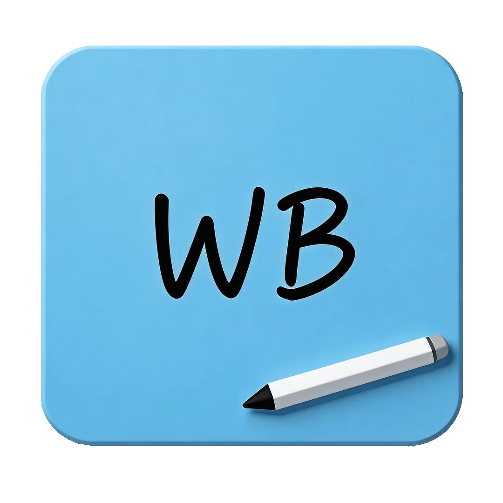
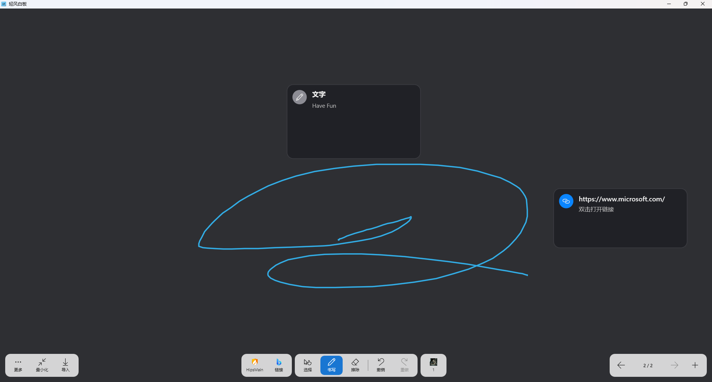
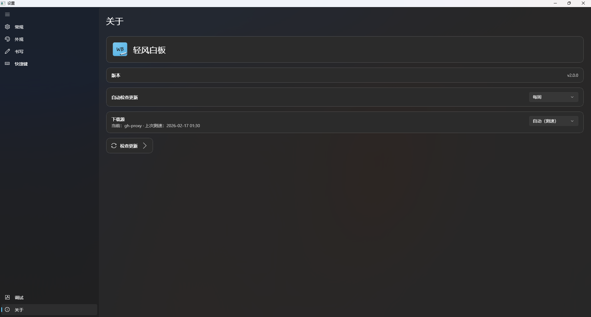

[简体中文](./README.md) | [English](./README_EN.md)

  

  <h2><strong>轻风白板</strong></h2>

  开源、简洁、易上手的电子白板

---

   [![zread](https://img.shields.io/badge/Ask_Zread-_.svg?style=flat&color=00b0aa&labelColor=000000&logo=data%3Aimage%2Fsvg%2Bxml%3Bbase64%2CPHN2ZyB3aWR0aD0iMTYiIGhlaWdodD0iMTYiIHZpZXdCb3g9IjAgMCAxNiAxNiIgZmlsbD0ibm9uZSIgeG1sbnM9Imh0dHA6Ly93d3cudzMub3JnLzIwMDAvc3ZnIj4KPHBhdGggZD0iTTQuOTYxNTYgMS42MDAxSDIuMjQxNTZDMS44ODgxIDEuNjAwMSAxLjYwMTU2IDEuODg2NjQgMS42MDE1NiAyLjI0MDFWNC45NjAxQzEuNjAxNTYgNS4zMTM1NiAxLjg4ODEgNS42MDAxIDIuMjQxNTYgNS42MDAxSDQuOTYxNTZDNS4zMTUwMiA1LjYwMDEgNS42MDE1NiA1LjMxMzU2IDUuNjAxNTYgNC45NjAxVjIuMjQwMUM1LjYwMTU2IDEuODg2NjQgNS4zMTUwMiAxLjYwMDEgNC45NjE1NiAxLjYwMDFaIiBmaWxsPSIjZmZmIi8%2BCjxwYXRoIGQ9Ik00Ljk2MTU2IDEwLjM5OTlIMi4yNDE1NkMxLjg4ODEgMTAuMzk5OSAxLjYwMTU2IDEwLjY4NjQgMS42MDE1NiAxMS4wMzk5VjEzLjc1OTlDMS42MDE1NiAxNC4xMTM0IDEuODg4MSAxNC4zOTk5IDIuMjQxNTYgMTQuMzk5OUg0Ljk2MTU2QzUuMzE1MDIgMTQuMzk5OSA1LjYwMTU2IDE0LjExMzQgNS42MDE1NiAxMy43NTk5VjExLjAzOTlDNS42MDE1NiAxMC42ODY0IDUuMzE1MDIgMTAuMzk5OSA0Ljk2MTU2IDEwLjM5OTlaIiBmaWxsPSIjZmZmIi8%2BCjxwYXRoIGQ9Ik0xMy43NTg0IDEuNjAwMUgxMS4wMzg0QzEwLjY4NSAxLjYwMDEgMTAuMzk4NCAxLjg4NjY0IDEwLjM5ODQgMi4yNDAxVjQuOTYwMUMxMC4zOTg0IDUuMzEzNTYgMTAuNjg1IDUuNjAwMSAxMS4wMzg0IDUuNjAwMUgxMy43NTg0QzE0LjExMTkgNS42MDAxIDE0LjM5ODQgNS4zMTM1NiAxNC4zOTg0IDQuOTYwMVYyLjI0MDFDMTQuMzk4NCAxLjg4NjY0IDE0LjExMTkgMS42MDAxIDEzLjc1ODQgMS42MDAxWiIgZmlsbD0iI2ZmZiIvPgo8cGF0aCBkPSJNNCAxMkwxMiA0TDQgMTJaIiBmaWxsPSIjZmZmIi8%2BCjxwYXRoIGQ9Ik00IDEyTDEyIDQiIHN0cm9rZT0iI2ZmZiIgc3Ryb2tlLXdpZHRoPSIxLjUiIHN0cm9rZS1saW5lY2FwPSJyb3VuZCIvPgo8L3N2Zz4K&logoColor=ffffff)](https://zread.ai/Jerry-Z07/WindBoard) 

> [!NOTE]
> 功能与 API 仍可能调整，用于生产环境前请谨慎评估。  

> [!IMPORTANT]
> 本项目完全使用 AI 开发，无法接受这一点的请另选软件。  
> 软件仍在完善，用于课堂等正式场合前请评估稳定性风险。

## 软件截图

查看截图

## 功能

- 基础书写（粗细、颜色、擦除、撤销/重做等）
- 导出与导入
- 多页面管理
- 无界书写
- 多语言支持
- 屏幕批注

## 特点

- 可自定义 Dock 栏
- 伪装：软件外显为自定义的图标与进程名

## 技术栈

- UI：WinUI 3（Windows App SDK）
- 渲染：DirectX（Vortice.Direct2D1 / Vortice.Direct3D11）
- 运行时：.NET 10（`net10.0-windows`）
- 序列化：System.Text.Json + 自定义工作区格式（WBIX）
- 测试：xUnit（`WindBoard.Tests`）
- 打包：MSIX（经 Microsoft Store 分发）+ 便携版 zip（Inno Setup 已停发，`installer/` 保留用于回滚）

## 快速开始

- 安装版：前往 [Microsoft Store](https://apps.microsoft.com/detail/9NGWWJ9WGKBX) 安装
- 便携版：前往 [Releases](https://github.com/Jerry-Z07/WindBoard/releases/latest) 下载 zip 解压即用

<!--
  官方 Product ID 为 9NGWWJ9WGKBX，同值亦见于 WindBoard/Updates/UpdateConstants.cs（StoreProductId，应用内跳转）。
  .github/workflows/release.yml 在仓库变量 vars.MSIX_STORE_PRODUCT_ID 未配置时仍会回退到占位值。
-->

## 贡献

欢迎提交 Issue 和 Pull Request。

### 开发环境要求

- .NET 10.0 SDK
- Windows 10/11（最低支持 `10.0.19041.0`）
- 开发工具：
  - Visual Studio 2026 或更高版本
  - JetBrains Rider 2025.3.1 或更高版本
  - Visual Studio Code

### 构建与测试

- 构建：`dotnet build WindBoard.slnx -c Release`
- 测试：`dotnet test WindBoard.slnx`

### 参与翻译

见 [本地化约定](./docs/dev/guides/localization.zh-CN.md)。

## Todo / 仍需完善的部分

- [ ] UI 统一和美化
- [ ] 更优化的笔迹平滑算法
- [ ] 触摸面积识别算法（用于掌擦逻辑）
- [ ] 软件整体性能优化
- [ ] 完善文档

## 生态

笔迹状态保存在私有格式 `.wbix` 中。  
格式说明见 [WBIX 格式](./docs/dev/guides/wbix.zh-CN.md)。

## 许可证

Apache License 2.0
