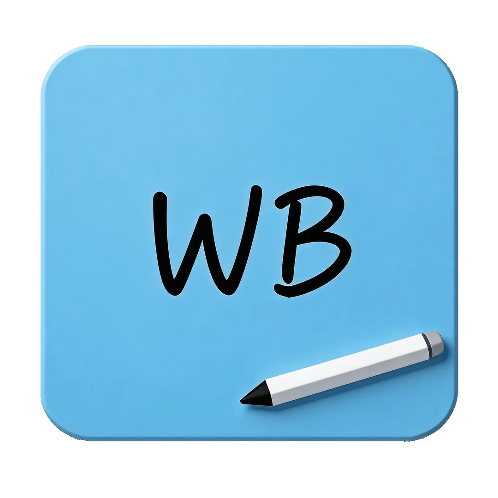
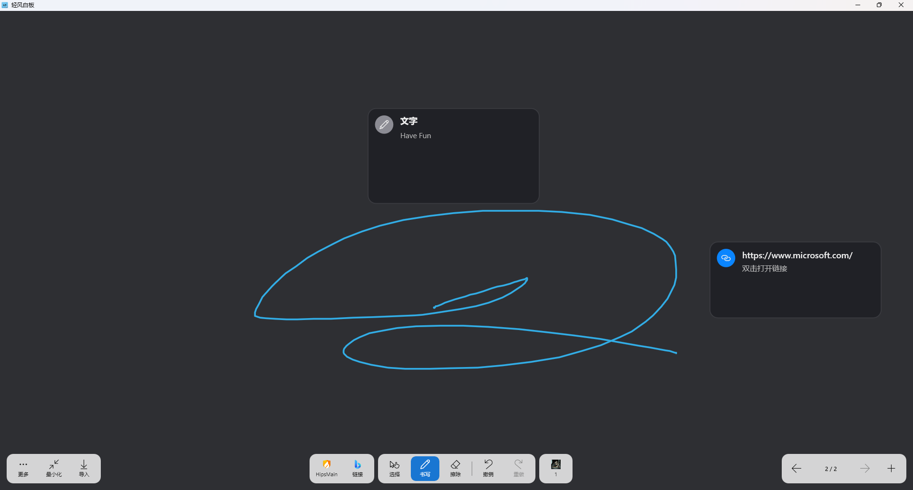
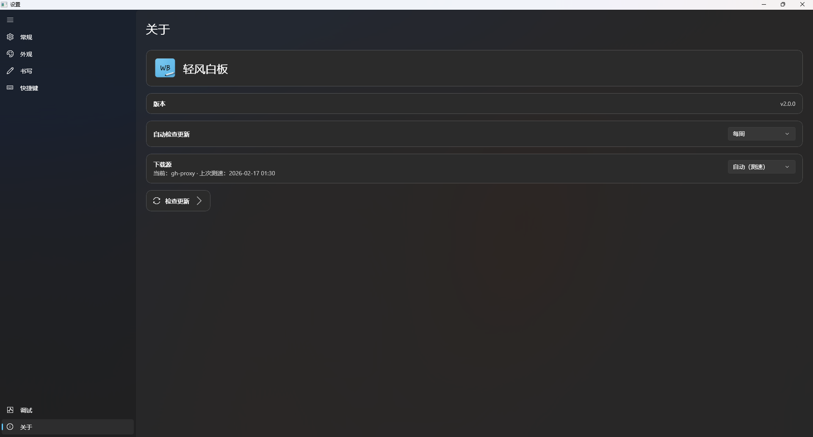

[English](./README.en.md) | [简体中文](./README.md)

  

  <h2><strong>WindBoard</strong></h2>

  An open-source, simple, and easy-to-use whiteboard for Windows

---

   [![zread](https://img.shields.io/badge/Ask_Zread-_.svg?style=flat&color=00b0aa&labelColor=000000&logo=data%3Aimage%2Fsvg%2Bxml%3Bbase64%2CPHN2ZyB3aWR0aD0iMTYiIGhlaWdodD0iMTYiIHZpZXdCb3g9IjAgMCAxNiAxNiIgZmlsbD0ibm9uZSIgeG1sbnM9Imh0dHA6Ly93d3cudzMub3JnLzIwMDAvc3ZnIj4KPHBhdGggZD0iTTQuOTYxNTYgMS42MDAxSDIuMjQxNTZDMS44ODgxIDEuNjAwMSAxLjYwMTU2IDEuODg2NjQgMS42MDE1NiAyLjI0MDFWNC45NjAxQzEuNjAxNTYgNS4zMTM1NiAxLjg4ODEgNS42MDAxIDIuMjQxNTYgNS42MDAxSDQuOTYxNTZDNS4zMTUwMiA1LjYwMDEgNS42MDE1NiA1LjMxMzU2IDUuNjAxNTYgNC45NjAxVjIuMjQwMUM1LjYwMTU2IDEuODg2NjQgNS4zMTUwMiAxLjYwMDEgNC45NjE1NiAxLjYwMDFaIiBmaWxsPSIjZmZmIi8%2BCjxwYXRoIGQ9Ik00Ljk2MTU2IDEwLjM5OTlIMi4yNDE1NkMxLjg4ODEgMTAuMzk5OSAxLjYwMTU2IDEwLjY4NjQgMS42MDE1NiAxMS4wMzk5VjEzLjc1OTlDMS42MDE1NiAxNC4xMTM0IDEuODg4MSAxNC4zOTk5IDIuMjQxNTYgMTQuMzk5OUg0Ljk2MTU2QzUuMzE1MDIgMTQuMzk5OSA1LjYwMTU2IDE0LjExMzQgNS42MDE1NiAxMy43NTk5VjExLjAzOTlDNS42MDE1NiAxMC42ODY0IDUuMzE1MDIgMTAuMzk5OSA0Ljk2MTU2IDEwLjM5OTlaIiBmaWxsPSIjZmZmIi8%2BCjxwYXRoIGQ9Ik0xMy43NTg0IDEuNjAwMUgxMS4wMzg0QzEwLjY4NSAxLjYwMDEgMTAuMzk4NCAxLjg4NjY0IDEwLjM5ODQgMi4yNDAxVjQuOTYwMUMxMC4zOTg0IDUuMzEzNTYgMTAuNjg1IDUuNjAwMSAxMS4wMzg0IDUuNjAwMUgxMy43NTg0QzE0LjExMTkgNS42MDAxIDE0LjM5ODQgNS4zMTM1NiAxNC4zOTg0IDQuOTYwMVYyLjI0MDFDMTQuMzk4NCAxLjg4NjY0IDE0LjExMTkgMS42MDAxIDEzLjc1ODQgMS42MDAxWiIgZmlsbD0iI2ZmZiIvPgo8cGF0aCBkPSJNNCAxMkwxMiA4TDQgMTJaIiBmaWxsPSIjZmZmIi8%2BCjxwYXRoIGQ9Ik00IDEyTDEyIDgiIHN0cm9rZT0iI2ZmZiIgc3Ryb2tlLXdpZHRoPSIxLjUiIHN0cm9rZS1saW5lY2FwPSJyb3VuZCIvPgo8L3N2Zz4K&logoColor=ffffff)](https://zread.ai/Jerry-Z07/WindBoard) 

> [!NOTE]
> APIs and features may still change; evaluate them before relying on this in production.  

> [!IMPORTANT]
> This project is developed entirely with AI. If that is not acceptable, choose another app.  
> The software is still maturing; weigh stability risk before using it in classrooms or other formal settings.

## Screenshots

View screenshots

## Features
- Basic inking (thickness, color, eraser, undo/redo, and more)
- Export and import
- Multi-page management
- Infinite canvas
- Multi-language support

### Highlights
- Customizable Dock bar
- Disguise mode: the app appears with a custom icon and process name

## Tech stack
- UI: WinUI 3 (Windows App SDK)
- Rendering: DirectX (Vortice.Direct2D1 / Vortice.Direct3D11)
- Runtime: .NET 10 (`net10.0-windows`)
- Serialization: System.Text.Json + custom workspace format (WBIX)
- Tests: xUnit (`WindBoard.Tests`)
- Packaging: MSIX (distributed via Microsoft Store) + portable zip (Inno Setup is discontinued; its script is kept in `installer/` for rollback only)

## Quick start

- Installer version: install from the [Microsoft Store](https://apps.microsoft.com/detail/9NGWWJ9WGKBX)
- Portable version: download the zip from [Releases](https://github.com/Jerry-Z07/WindBoard/releases/latest) and extract it

<!--
  The official Product ID is 9NGWWJ9WGKBX; the same value lives in WindBoard/Updates/UpdateConstants.cs (StoreProductId, in-app navigation).
  .github/workflows/release.yml still falls back to the placeholder when the repo variable vars.MSIX_STORE_PRODUCT_ID is not configured.
-->

## Contributing
Issues and pull requests are welcome.

### Development Environment Requirements
- .NET 10.0 SDK
- Windows 10/11 (minimum `10.0.19041.0`)
- Development Tools:
  - Visual Studio 2026 or later
  - JetBrains Rider 2025.3.1 or later
  - Visual Studio Code

### Build & Test
- Build: `dotnet build WindBoard.slnx -c Release`
- Test: `dotnet test WindBoard.slnx`

### Contributing Translations
See [Localization Conventions](./docs/dev/guides/localization.en-US.md).

## Roadmap / TODO
- [ ] UI unification and beautification
- [ ] Better stroke smoothing algorithm
- [ ] Touch area detection algorithm (for palm eraser)
- [ ] Overall performance optimization
- [ ] Complete documentation

## File format
Ink state is stored in a private format: `.wbix`.  
See [WBIX format](./docs/dev/guides/wbix.en-US.md).

## License
Apache License 2.0

